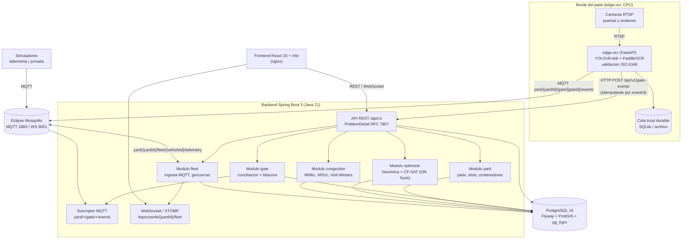

# C4 — Contenedores del sistema (nivel 2)

> Contexto: patio de contenedores en Costa Rica. Camaras RTSP en las puertas, servicio OCR en el borde,
> backend transaccional, optimizador OR-Tools dentro del backend, PostgreSQL, Mosquitto y frontend React.
> Todo se ejecuta localmente (Linux + Docker), sin servicios de nube.

## Flujos principales

| # | Flujo | Transporte | Notas |
|---|---|---|---|
| 1 | Lectura OCR -> backend | HTTP `POST /api/v1/gate-events` | Idempotencia por `eventId`; reintento exponencial con cola local durable en el borde. |
| 2 | Lectura OCR -> evento | MQTT `yard/{yardId}/gate/{gateId}/events` | Canal alterno/telemetria de eventos para replay y auditoria. |
| 3 | Consecuencia de la lectura | Suscripcion MQTT `yard/+/gate/+/events` | El backend tambien escucha para no depender de un solo camino. |
| 4 | Telemetria de flota | MQTT `yard/{yardId}/fleet/{vehicleId}/telemetry` | 1-5 s por vehiculo; validacion de esquema y descarte de posiciones imposibles. |
| 5 | Difusion al operador | WebSocket/STOMP | Posiciones agregadas con throttle de 1 s; alertas de congestion. |
| 6 | Consulta de patio | REST | Slots, ocupacion, recomendacion Top-3 del optimizador. |

## Decisiones de despliegue

- **Sin dependencia de nube**: todos los componentes son contenedores open source locales.
- **El borde no depende del backend**: si el backend cae, edge-ocr encola y reintenta sin perder eventos.
- **El optimizador vive dentro del backend**: evita un servicio mas y permite usar la misma conexion a datos.
- **PostgreSQL como fuente de verdad** para patio, bitacora, flota y pronosticos persistidos.
